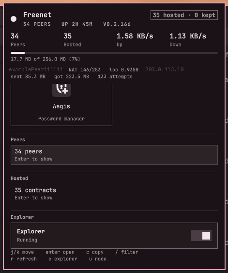

# Freenet for Omarchy

A bar icon and keyboard panel for Omarchy users who run, or want to run, a Freenet node on their own machine.



The listing image uses a sample peer id and the documentation address 203.0.113.10. It shows the Aegis tile and the Explorer switch. Peers and hosted contracts start collapsed.

## At a glance

- A bar glyph shows whether your node and Freenet Explorer are running.
- The panel shows peer count, traffic, storage, the apps your node lists, Aegis when it is set up, and a switch to start or stop Freenet Explorer.
- It does not install Freenet, does not run an installer, does not need root, and never listens on a port. It only talks to the node at `127.0.0.1:7509` and the explorer at `127.0.0.1:8787`.
- This is the Rust Freenet from https://freenet.org/, not the old Java Freenet (Hyphanet). The AUR package named `freenet` is that old client.

The glyph refreshes every 10 seconds:

| State | Meaning | Glyph |
| --- | --- | --- |
| node down | nothing accepts `127.0.0.1:7509` | dim hollow ring |
| node up, explorer stopped | 7509 accepts, 8787 does not | urgent-colored ring with a dot |
| both running | 7509 and 8787 accept | three linked dots in the bar color |

Left-click the glyph to open the panel.

The name on the bar and in the launcher is Freenet. Plugin id: `io.mcmurray.freenet-explorer`. License: [MIT](LICENSE). The id stays, so an install that already uses it keeps working. The Aegis tile icon is Material Symbols Outlined `encrypted_add`, Apache-2.0, Google, kept in `aegis.svg`.

## Requirements

- Omarchy with the shell plugin system (verified on 4.5.0).
- The Rust Freenet node from https://freenet.org/quickstart/, listening on `127.0.0.1:7509`. The AUR package named `freenet` is the old Java client and must not be used.
- A Freenet Explorer checkout, if you want the explorer. Its `run.sh` starts the UI on `127.0.0.1:8787`.
- `curl` and `systemctl`, which a normal Omarchy install already has.

The plugin does not install packages, does not run the Freenet installer, and does not need root.

## Install

```bash
omarchy plugin add https://github.com/imcmurray/omarchy-freenet-explorer.git --enable
```

`--enable` places the glyph on the right of the bar. Pick another section when prompted, or move it later:

```bash
omarchy bar move io.mcmurray.freenet-explorer --section right
```

Any other git URL works the same way:

```bash
omarchy plugin add <git-url> --enable --yes
```

`--yes` skips the unsandboxed-code confirm. Without a terminal, add refuses to continue unless `--yes` is passed.

If the bar does not show the glyph, run `omarchy-restart-shell`.

## One-time setup

Plugins cannot ship a systemd unit. Run this once after install:

```bash
~/.config/omarchy/plugins/io.mcmurray.freenet-explorer/bin/setup
```

If the file is not executable, run it with `bash` followed by the same path.

It writes `~/.config/systemd/user/freenet-explorer.service`, which runs the explorer's `run.sh`, and reloads systemd. It does not enable or start the unit. It does not need root and does not download anything.

- `FREENET_EXPLORER_DIR` points it at a checkout other than `~/Development/freenet-explorer`. If that directory has no `run.sh`, setup uses `~/Development/freenet-explorer`.
- `bin/setup --check` reports what is present and changes nothing.
- `bin/setup --remove` stops and deletes the unit it wrote.

A unit file that this script did not write is never overwritten or removed.

Optionally, to start the explorer at login:

```bash
systemctl --user enable --now freenet-explorer
```

The panel's Start button does not need this.

"Open kept files" opens `~/.local/share/freenet-explorer/kept`, or `$FREENET_EXPLORER_KEPT` when that variable is set in the shell's environment. The explorer creates the folder on the first Keep. The plugin does not create it.

## What the panel shows

The top of the panel is this node's own dashboard: peer count, up and down rates, storage, and the apps from its Freenet Links list, plus Freenet Explorer, the peer UI, and Aegis. Each app is a block with its icon and its name. The hosted count at the top right opens the peer UI.

Numbers, peer rows, and app names come from http://127.0.0.1:7509/, and only while the panel is open. The hosted and kept counts in the title come from the explorer's `GET /api/summary`.

When the node is not running, or it is up and has no peers, the first rows say how to install it, start the user service, or open the peer UI.

Enter on a collapsed row shows the peers or the hosted contracts. Enter on a Freenet app, a peer, a contract, or Aegis opens that page in the browser through `127.0.0.1:7509` only. Enter on Freenet Explorer opens http://127.0.0.1:8787/. The Explorer row is a switch: on starts the user service, off stops it.

`c` copies a peer address, a contract key, or this node's peer id. Copied text is one token of letters, digits, and `:./_-`, at most 180 characters. `/` filters the list and still searches inside a collapsed section.

| Row | Enter does |
| --- | --- |
| Start Freenet node | Starts the official **user** unit, and only when that unit is installed |
| Not connected yet | Opens the peer UI. Shown when the node is up and has zero peers |
| Freenet Explorer | Opens http://127.0.0.1:8787/ |
| Peer UI | Opens http://127.0.0.1:7509/ |
| Hosted count | Opens the peer UI |
| An app from Freenet Links | Opens `http://127.0.0.1:7509/v1/contract/web/<id>/` |
| Aegis | Opens the local web container from `~/.config/freenet/aegis-web.path` |
| N peers / N contracts | Shows or hides that list. The count is the dashboard's own count |
| A peer | Opens `http://127.0.0.1:7509/peer/<address>` |
| A hosted contract | Opens `http://127.0.0.1:7509/contract/<key>` |
| Explorer switch | `systemctl --user start` or `stop` on `freenet-explorer.service` |
| Open explorer | Opens http://127.0.0.1:8787/ |
| Open peer UI | Opens http://127.0.0.1:7509/ |
| Open kept files | Opens the kept folder in the file manager, if it exists |

### Keyboard

| Key | Action |
| --- | --- |
| j / k, or Up / Down | Move |
| Enter | Activate the row |
| c | Copy the row's address or key |
| / | Filter. Esc clears the filter |
| r | Refresh |
| e | Open the explorer |
| u | Open the peer UI |
| Esc | Close the panel |
| Tab | Move to the next panel in the bar section |

## Apps, Aegis, and Explorer

Freenet is a peer-to-peer network. This computer runs one peer. Other peers are the rest of the network. The panel is how you look at this peer and open what it is hosting.

The peer UI at http://127.0.0.1:7509/ is the node's own dashboard. App tiles come from that dashboard's Freenet Links list, and each one opens only on `127.0.0.1:7509`. The panel does not invent contract ids. If this node does not list an app, that tile is not shown. [Freenet Explorer](https://github.com/freenet/freenet-explorer) and the peer UI are this machine's own pages, so they are shown beside that list.

Aegis is the password manager. The tile is shown when the node is connected and `~/.config/freenet/aegis-web.path` holds the web-container path this peer serves, so Aegis runs in Freenet mode. The GitHub Pages site stays a browser vault: this peer refuses its websocket. The vault delegate is registered on the peer, once, by Aegis itself. This plugin does not register it, and the tile does not add `register=1`.

Freenet Explorer is the local index at http://127.0.0.1:8787/. The switch at the bottom starts and stops that user service. Kept files belong to the explorer.

The plugin does not install Freenet, publish a website, or register a delegate.

## Freenet node

The explorer needs a Freenet node. The Linux install, from https://freenet.org/quickstart/, is the command on that page:

```text
curl -fsSL https://freenet.org/install.sh | sh
```

This is information only: the plugin never runs it. When that installer's `freenet.service` **user** unit is present, the panel offers "Start Freenet node". A binary with no user unit is explained in the panel, with links to the quickstart and the uninstall page. The panel does not start a system service and does not invent an install command of its own.

For a server there is also a Docker image: https://freenet.org/quickstart/docker/. The panel does not mention Docker and does not run it.

## IPC

```bash
omarchy-shell io.mcmurray.freenet-explorer start
omarchy-shell io.mcmurray.freenet-explorer stop
omarchy-shell io.mcmurray.freenet-explorer open
omarchy-shell io.mcmurray.freenet-explorer status
```

`status` prints one line:

```text
node=down explorer=stopped hosted=unknown
node=up explorer=stopped hosted=unknown
node=up explorer=running hosted=12
```

`hosted` is `unknown` unless the explorer reported a count.

`start`, `stop`, and `open` print `ok` or `error: …`. For `start` and `stop`, `ok` means `systemctl` was launched. A later failure shows in the panel. `open` opens the explorer UI and does not start the explorer.

To open the bar panel instead:

```bash
omarchy-shell shell summon io.mcmurray.freenet-explorer
```

## Launcher

While the plugin is enabled, its service keeps `~/.local/share/applications/io.mcmurray.freenet-explorer.desktop`. "Freenet" then appears in the SUPER+SPACE menu and the SUPER+ALT+SPACE app grid. A file at that path that the plugin did not write is left alone.

## Example keybinding

Not installed by the plugin. To add one, put this in `~/.config/hypr/bindings.lua`:

```lua
o.bind("SUPER + CTRL + F", "Freenet", "omarchy-shell io.mcmurray.freenet-explorer open")
```

## Uninstall

1. Remove the unit:

   ```bash
   ~/.config/omarchy/plugins/io.mcmurray.freenet-explorer/bin/setup --remove
   ```

2. Remove the plugin:

   ```bash
   omarchy plugin remove io.mcmurray.freenet-explorer
   ```

3. If the shell was not running during removal, delete `~/.local/share/applications/io.mcmurray.freenet-explorer.desktop` by hand.
4. The explorer's data under `~/.local/share/freenet-explorer/` is left alone. So is the Freenet node.

## Security

The plugin must not weaken Freenet or Freenet Explorer.

- It never listens on a port, never proxies 8787 or 7509, never changes the firewall, and never passes the explorer a port or bind address.
- Its only HTTP request to the explorer is a GET of `http://127.0.0.1:8787/api/summary` with the default Host header, a two-second limit, and a 64 KiB cap.
- While a popup is open and port 7509 accepts a connection, it also GETs `http://127.0.0.1:7509/` and reads the peer count, the Freenet Links names, the peer table, and the hosting table. For each of those apps it then GETs that contract's own page, capped at 64 KiB, and keeps an icon only when that page links one on the same contract. It does not follow redirects, other hosts, or any other link. A place opens only as `http://127.0.0.1:7509/v1/contract/web/<id>/` from that list. A peer opens only as `http://127.0.0.1:7509/peer/<address>` and a hosted contract only as `http://127.0.0.1:7509/contract/<key>`. Aegis opens only as `http://127.0.0.1:7509/v1/contract/web/<id>/`, and only when `~/.config/freenet/aegis-web.path` contains that path. The plugin does not open the GitHub Pages site. The Freenet Explorer tile opens only `http://127.0.0.1:8787/`. The Peer UI tile and the hosted count open only `http://127.0.0.1:7509/`.
- It never calls the explorer endpoints that make the node act.
- It never shows contract bytes or kept-file contents. Place names are plain text taken from that link list. It shows a count and runs local commands.
- It does not read or write the explorer database. It only checks that the kept folder exists and opens it. The child-safety quarantine lives in that database and is left alone.
- Commands run as argument lists. Shell scripts are fixed text, and paths are passed to them as arguments.
- It never asks for root access or shows a permission prompt.
- Displayed text is plain text. Peer addresses are IPv4. The dashboard fetch is capped at 256 KiB and is not followed across redirects.

The implementation notes for this machine are in [docs/PLUGIN-CONTRACT.md](docs/PLUGIN-CONTRACT.md). A draft marketplace listing, not yet submitted, is in [docs/MARKETPLACE.md](docs/MARKETPLACE.md).
